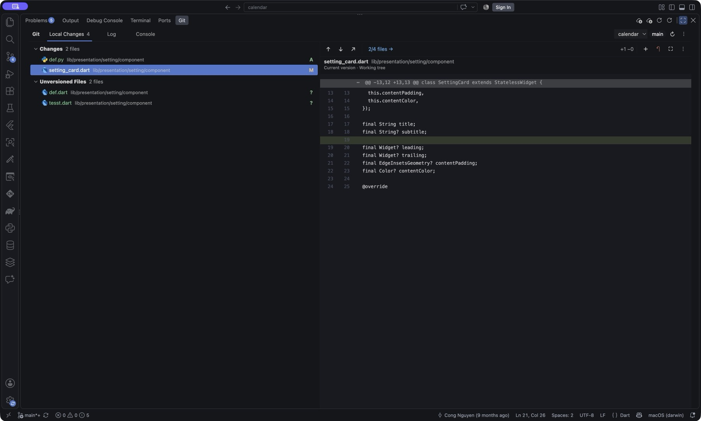
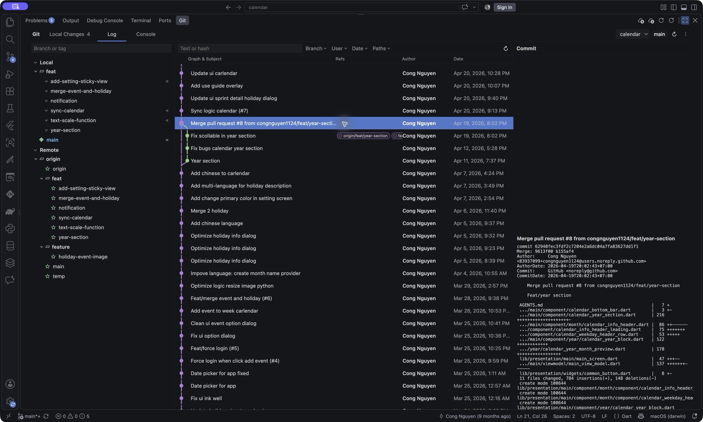
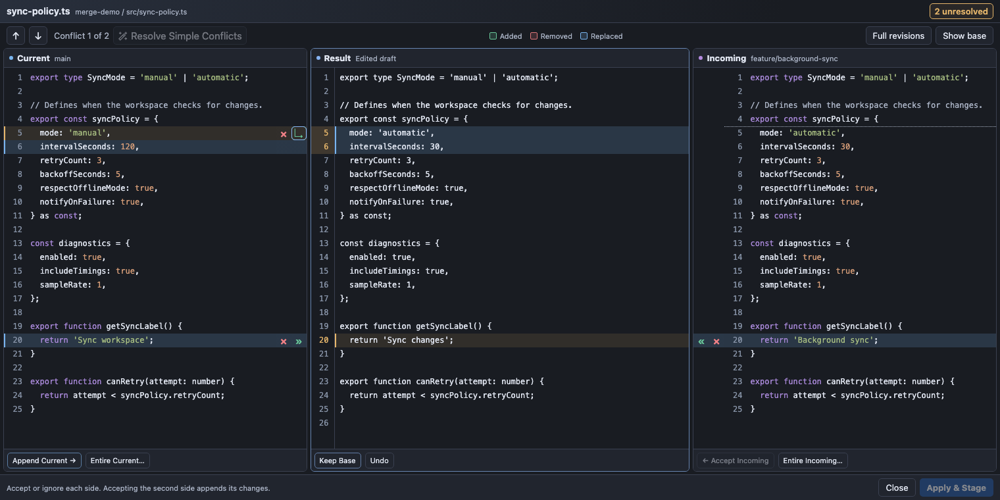
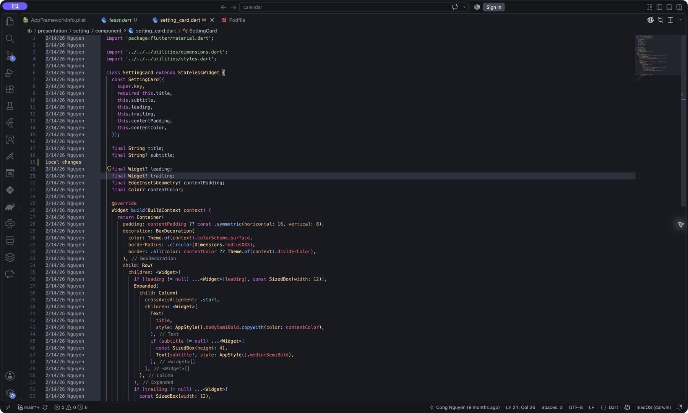

  

<h1 align="center">VC Smart Git</h1>

  A JetBrains-inspired Git tool window for Visual Studio Code.

VC Smart Git keeps local changes, history, conflict resolution, and Git blame in one bottom panel without replacing VS Code's built-in Source Control view.

## Screenshots

### Local Changes

Review tracked and unversioned files side by side with a compact inline diff and quick Git actions.

### Log

Explore local and remote branches alongside a colored multi-lane commit graph, references, authors, dates, changed files, and commit details.

### Merge Editor

Compare Current and Incoming in a compact three-pane editor, resolve simple conflicts in one action, and edit Result before staging.

### Git Blame

Annotate the active editor with commit dates and authors. Recent commits use deeper green shading.

## Highlights

- **JetBrains-style bottom tool window** with Local Changes, Log, and Console tabs.
- **Activity Bar launcher** that opens Smart Git directly in the bottom panel.
- **Theme-aware file presentation** using Material Icon Theme when it is installed, plus VS Code Git decoration colors.
- **Compact inline diff preview** with file navigation, changed-line counts, Stage, Unstage, Rollback, maximize, and file actions.
- **Git status groups that match the index:** tracked, staged, modified, deleted, renamed, and conflicted files appear under Changes; only `??` files appear under Unversioned Files.
- **Context menus throughout the UI**, modeled after JetBrains Git actions.

## Local Changes

The Local Changes tab provides a focused working-tree workflow:

- View tracked changes and unversioned files in separate collapsible sections.
- Select ranges with **Shift** and add or remove individual files with **Cmd/Ctrl**, then run Stage, Unstage, or Rollback for the complete selection.
- Press **Delete** (or **Backspace** on macOS) to confirm and move the selected files to Trash; deleted tracked files remain visible in Changes with a muted gray style.
- Distinguish added, modified, deleted, renamed, untracked, and conflicted files using the active VS Code theme.
- Preview concise unified diffs without raw `diff --git` metadata.
- Open a file in the built-in VS Code Diff Editor or jump directly to its source.
- Stage or unstage individual files and all changes.
- Roll back staged and working-tree changes to `HEAD`, or move new files to Trash, with confirmation.
- Commit staged changes from the Changes context menu.
- Copy repository-relative file paths.

## Conflict Resolution

Open **Local Changes → Merge Conflicts → Resolve**. Select a file or choose **Resolve Manually** to open it in the Smart Git Merge Editor.

- Compare **Current** and **Incoming** alongside the editable **Result**. Switch to **Full revisions** for continuous source views or **Show base** to see the common ancestor when available.
- Scroll any pane to follow corresponding lines across the merge editor. Green marks additions, blue marks replacements, and red marks removals or ignored changes.
- Result starts from Base in unresolved regions and includes changes Git already merged. When the ancestor cannot be verified, choose a side or type the result you want.
- Use the inline **»** or **«** to accept one side of a conflict. The other side remains available. Accept it to append its changes, or select **×** to ignore it. Ignoring both sides keeps the verified Base.
- Select **Resolve Simple Conflicts** to combine non-overlapping changes against Base and accept identical changes. Edit Result directly and select **Keep Edited Result** to confirm a manual resolution. **Undo** restores the previous edit or merge action.
- Choose **Apply & Stage** after processing all conflicts. Smart Git checks for external changes to the file and index before saving. You can finish the active Git operation after resolving all files.
- Accept an entire revision or a deletion when that is the intended result. Files that cannot be edited as UTF-8 text use these whole-file actions.
- Use **Resolve Simple Conflicts** from the conflict list when both sides are identical or both deleted.

Destructive actions require confirmation by default.

## Log and Branches

The Log tab combines branch navigation, commit history, and commit details:

- Follow a colored multi-lane commit graph through branches and merges.
- Hover over a branch or graph node to highlight its first-parent history. Click a graph node to expand or collapse its revision details and parent links.
- Browse local and remote branches in a collapsible, path-aware tree with explicit HEAD, linked-worktree, ahead, and behind states.
- See accurate local, remote, tag, current checkout, and linked-worktree badges on the commit where each ref points.
- Drag the vertical splitters to resize the branch tree, commit history, and commit details panes; double-click a splitter to restore its default width.
- Filter commits by text or hash.
- Inspect branch/tag references, author, date, commit files, metadata, and full details.
- Right-click a commit for revision, checkout, compare, reset, revert, cherry-pick, branch, tag, and parent/child navigation actions.
- Open per-file commit diffs.
- Compare a commit with the current working tree.
- Create branches or tags from a commit.
- Checkout revisions, switch branches, and delete local branches.
- Cherry-pick or revert commits.
- Reset the current branch to a selected commit with confirmation.

## Annotate with Git Blame

Run **VC Smart Git: Annotate with Git Blame** from the Command Palette or editor context menu.

- Display author, revision, date, and commit summary beside each editor line.
- The annotation background gets greener and stronger for newer commits in the file.
- Click a committed blame annotation to reveal that commit in the Smart Git Log.
- Right-click an annotated line to show its diff, copy the revision, open the revision or its parent, or view it in the remote repository browser.
- Uncommitted lines are identified separately.

## Remote and Repository Operations

- Automatically discover Git repositories in the open workspace.
- Switch between multiple discovered repositories.
- Fetch all remotes.
- Pull using fast-forward-only mode.
- Push the current branch or publish a branch without an upstream.
- Follow built-in Git changes and refresh automatically.
- Review Git command activity in the Console tab.

## Getting Started

1. Install the extension and open a folder containing a Git repository.
2. Click the **Smart Git** icon in the Activity Bar, or run **VC Smart Git: Open Git Tool Window** from the Command Palette.
3. Use Local Changes for working-tree actions and Log for history and branch operations.

For the richest file icons, install and enable [Material Icon Theme](https://marketplace.visualstudio.com/items?itemName=PKief.material-icon-theme). VC Smart Git falls back gracefully when it is not installed.

## Settings

| Setting | Default | Description |
| --- | --- | --- |
| `vcSmartGit.gitPath` | `git` | Path to the Git executable. |
| `vcSmartGit.autoRefresh` | `true` | Refresh when repository or workspace state changes. |
| `vcSmartGit.logLimit` | `200` | Maximum commits loaded in the Log tab. |
| `vcSmartGit.confirmDestructiveActions` | `true` | Confirm rollback, branch deletion, reset, and abort actions. |

## Requirements

- Visual Studio Code 1.90 or newer.
- Git available on `PATH`, or configured through `vcSmartGit.gitPath`.

## Notes

VC Smart Git is inspired by JetBrains Git tooling but is an independent extension and is not affiliated with JetBrains. Repository-changing commands run through the Git executable configured in VS Code; credentials and authentication remain managed by your existing Git setup.

## License

[MIT](LICENSE)
